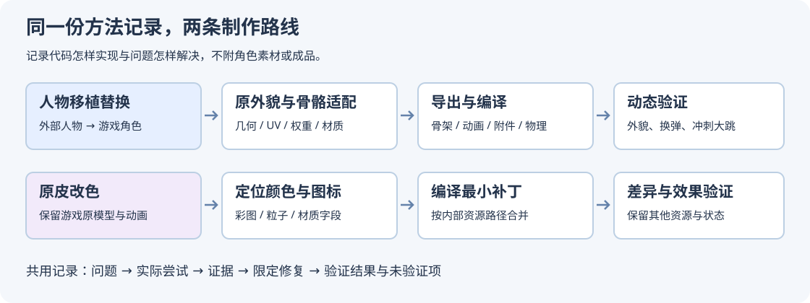
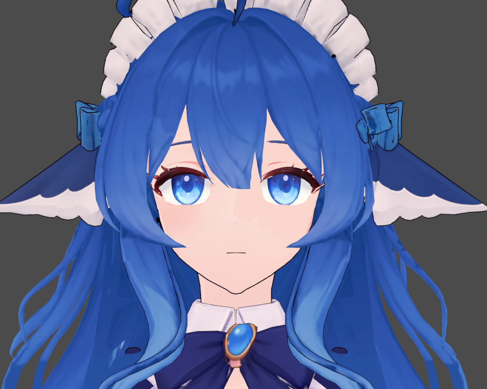
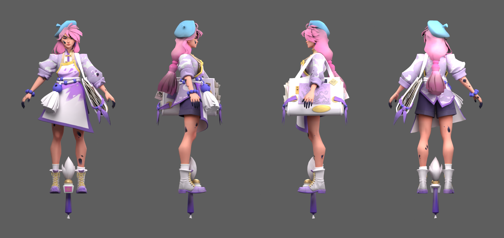

# Deadlock MOD 制作与排错记录

记录 Codex 怎样把两类 MOD 做出来：怎样分析输入、设计代码处理流程、尝试构建、定位失败、限定修复范围，再用文件和游戏结果验证。

这里的主线是**实现过程和问题复盘**。不是成品下载页，也不是逐个按钮的人工操作指南。

## 两条路线

| 路线 | 做什么 | 阅读 |
| --- | --- | --- |
| 人物移植替换 | 把另一个人物模型适配到游戏角色，处理骨骼、权重、材质转换、编译及动画问题 | [实现过程](workflows/model-replacement/README.md) · [构建与排错记录](workflows/model-replacement/CASES.md) |
| 原皮改色 | 沿用游戏人物模型，修改人物与武器彩图、普攻和技能颜色、界面图标，再编译合并 | [实现过程](workflows/original-skin-recolor/README.md) · [构建与排错记录](workflows/original-skin-recolor/CASES.md) |

这两条路线不能共用同一个“重建人物”的默认动作。原皮只改色，不需要重绑骨骼；已有绑定的人物只做局部修正，也不应重新跑新模型适配。

## 实际制作图片

| 人物移植：睫毛修复后的 Blender 预览 | 原皮改色：精修 05 的模型四视图 |
| --- | --- |
|  |  |

[查看全部 10 张制作图片](docs/IMAGES.md)：包含修复前后、游戏英雄展示、武器、技能彩图对照和细调器界面。上方两图是历史模型渲染；两条路线使用不同人物工程，不是同一模型的前后对比。

## 怎样看这些记录

每个案例尽量写清：**问题 → 实际尝试 → 查到的证据 → 修改 → 验证结果 → 未解决或未验证部分**。推测与确认的原因分开，代码检查与游戏目视检查分开。

- [共用的验证方法](docs/VERIFICATION.md)：几何、UV、资源差异、编译结构和最终画面各能证明什么。
- [工具与上游入口](docs/TOOLS.md)：只列名称、用途和来源，不附软件或 SDK。
- [记录模板](docs/RECORD_FORMAT.md)：以后继续开发时保留有效的构建尝试和结论。
- [Codex 方法技能](skills/deadlock-mod-methods/SKILL.md)：让下一次任务先选对路线，再读取案例。

## 公开范围

仓库包含方法文字、短代码思路、技能、示意图，以及用户明确允许展示的实际制作图片。**不包含任何 3D 模型、原始游戏贴图、MOD、软件安装包或完整工作包**；不公开聊天截图、私人聊天全文、账号信息和本机路径。

人物替换案例使用过外部模型，图片展示的是制作结果与排错过程，不提供模型文件，也不表示本仓库拥有该角色的设计或模型权利。原皮改色图片展示游戏原角色上的颜色处理，不随文档提供可提取使用的模型或原始纹理。

本次整理没有重新运行模型构建、改色、安装或游戏测试。历史结果按当时可核对的记录表述；版本改变后需要重新验证。来源和配图范围见 [SOURCES.md](SOURCES.md)。
