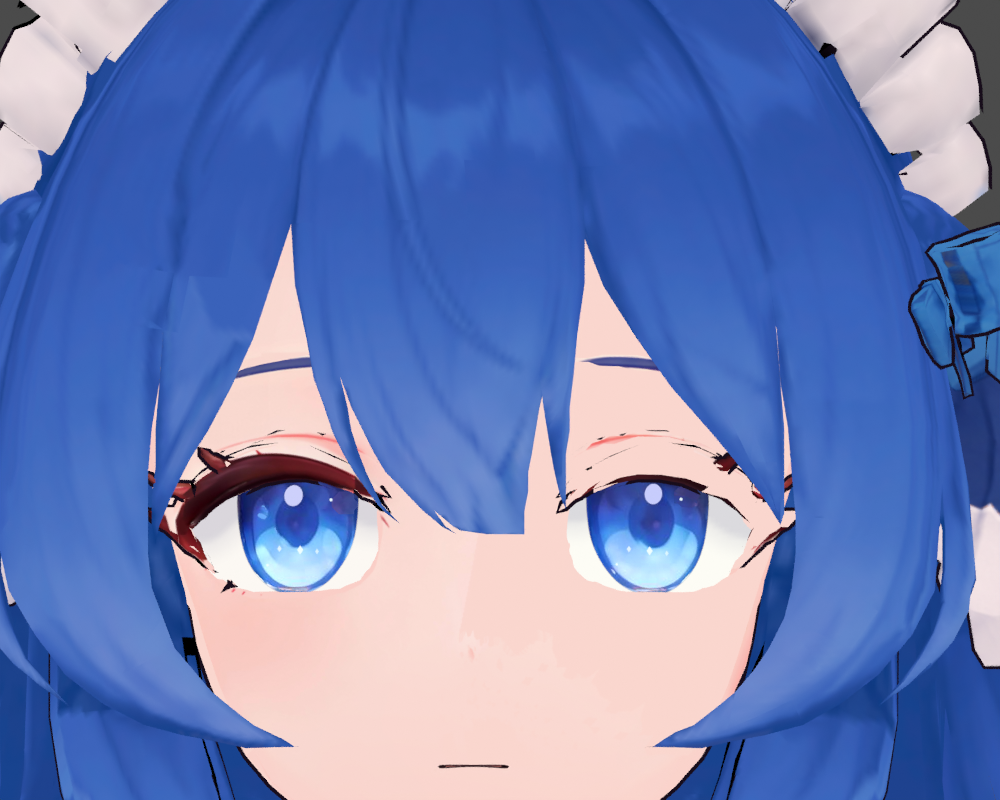
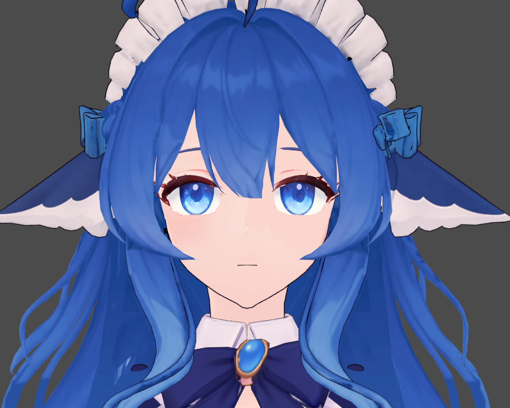
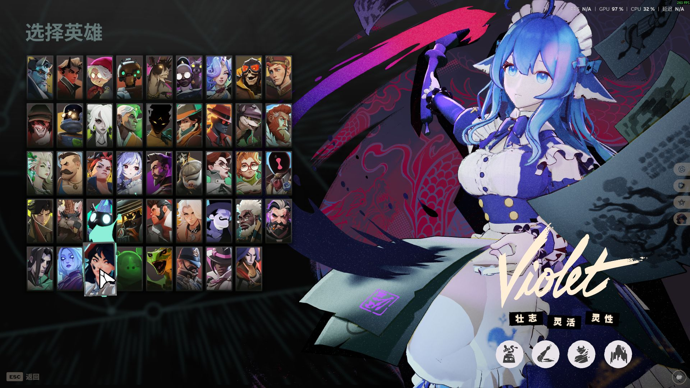
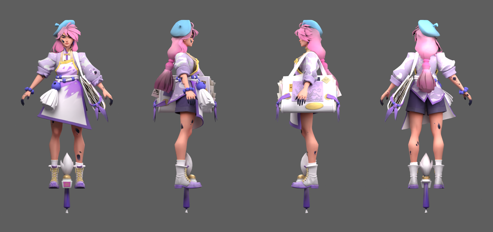
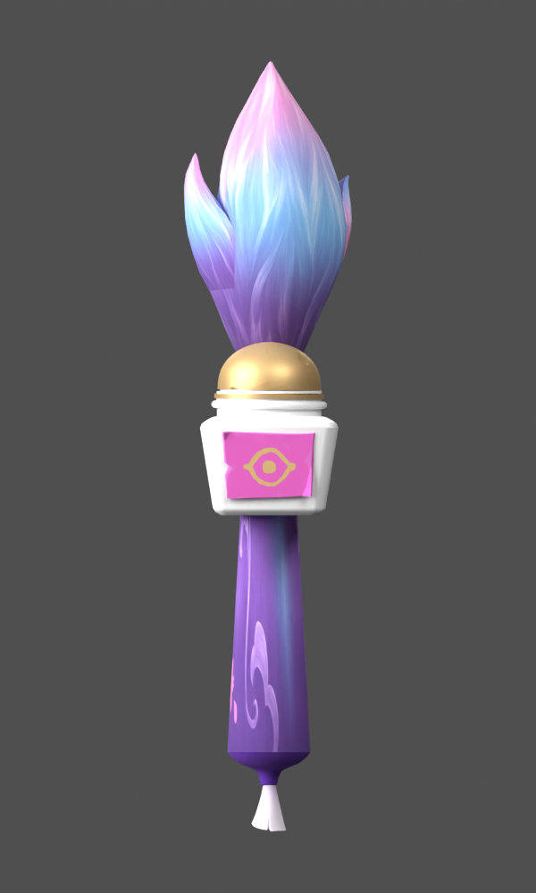
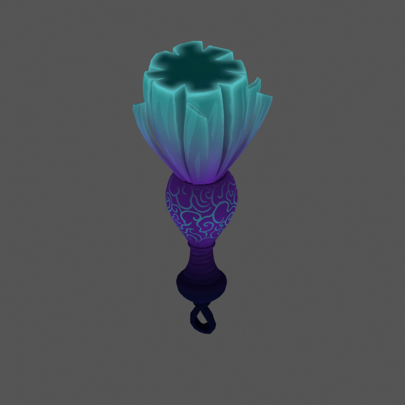
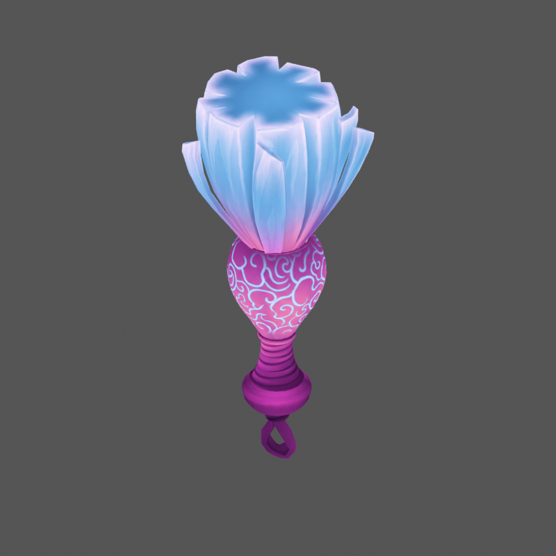
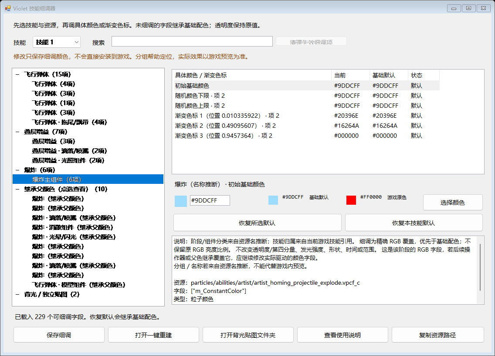
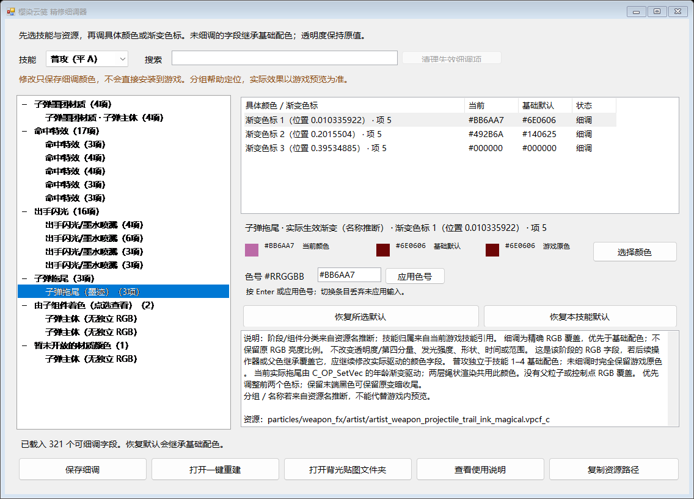

# 制作过程图集

以下 10 张图片来自实际制作记录，包括 Blender 渲染、游戏英雄展示和本地技能细调器界面。它们不是聊天截图，也不是概念生图。

本页只展示二维过程图片，不附模型文件、原始贴图或软件。发布副本去除图片文字元数据中的本机路径及 EXIF，图片画面保持原样。静态渲染、游戏英雄展示与动态技能／动作验收分别说明，不用一类图片代替另一类验证。

## 人物移植路线：睫毛修复记录

### Blender 中的外观检查

| 修复前：局部问题定位 | 修复后：正面外观检查 |
| --- | --- |
|  |  |

两图均为 1000×800 的 Blender 预览，分别记录问题定位与修复后的外观。取景不完全相同，不能作为同机位逐像素比较；它们也不能证明游戏动画或材质运行时效果正常。

### 游戏英雄展示中的检查

| 修复前的英雄展示 | 修复后的英雄展示 |
| --- | --- |
|  |  |

两图为 1920×1080 的游戏画面，能够记录当时英雄展示中的可见差异。它们不等于冲刺、大跳、长时间战斗或所有表情状态都完成了验收。

## 原皮改色路线：人物与武器配色

### 精修 05 的实际模型四视图

1800×850。粉色头发、天蓝帽子、白紫衣装与暖金细节的实际模型渲染，用于检查正面、侧面和背面的整体配色；这是原皮改色路线的精修阶段，不能与上方的人物移植路线混为同一模型工程。图片不是游戏截图。

### 武器满墨状态的静态预览

原图 600×1000。笔毛使用粉色、天蓝与紫色过渡，笔柄与金白细节统一配色。它说明独立武器彩图的制作结果，不代表游戏中状态切换、背光或动态发光已经逐项验收。

## 原皮改色路线：二技能正面彩图补漏

| 修复前：原彩图基础色 | 修复后：新的彩图基础色 |
| --- | --- |
|  |  |

两图均为 800×800，采用同一技能模型和相同视角，展示青紫配色到天蓝、粉紫配色的变化。它们对应“只改背光不能改变正面彩图”的排错过程，保留原轮廓与花纹布局。

这里检查的是静态基础色；游戏中还会叠加发光、透明度、粒子颜色与环境光。相关处理和验证边界见 [原皮改色案例](../workflows/original-skin-recolor/CASES.md)。

## 本地技能细调器：两个历史阶段

| 较早阶段：一技能界面 | 后续阶段：普攻拖尾界面 |
| --- | --- |
|  |  |

两图均为 1136×819。左图记录 229 字段阶段的一技能界面；右图记录 321 字段阶段的普攻拖尾，展示基础默认值、当前覆写值、渐变色标和资源对应关系。

这两张是实际应用界面的历史快照，不是最新 333 项目录的截图。字段数反映当时覆盖范围，界面中能编辑某一项也不自动证明该项已经在游戏里验证。此仓库记录细调器的数据组织和实现思路，不提供该程序安装包。

## 怎样使用这些图片

图片用于补充“问题出现在哪里、某次处理得到什么可见结果”的说明。是否只改了颜色、是否保留 UV／骨骼、哪些资源发生变化，仍需要代码检查、产物差异和收据证明，不能仅从外观相似推断。

继续阅读：[验证方法](VERIFICATION.md) · [工具索引](TOOLS.md)。
