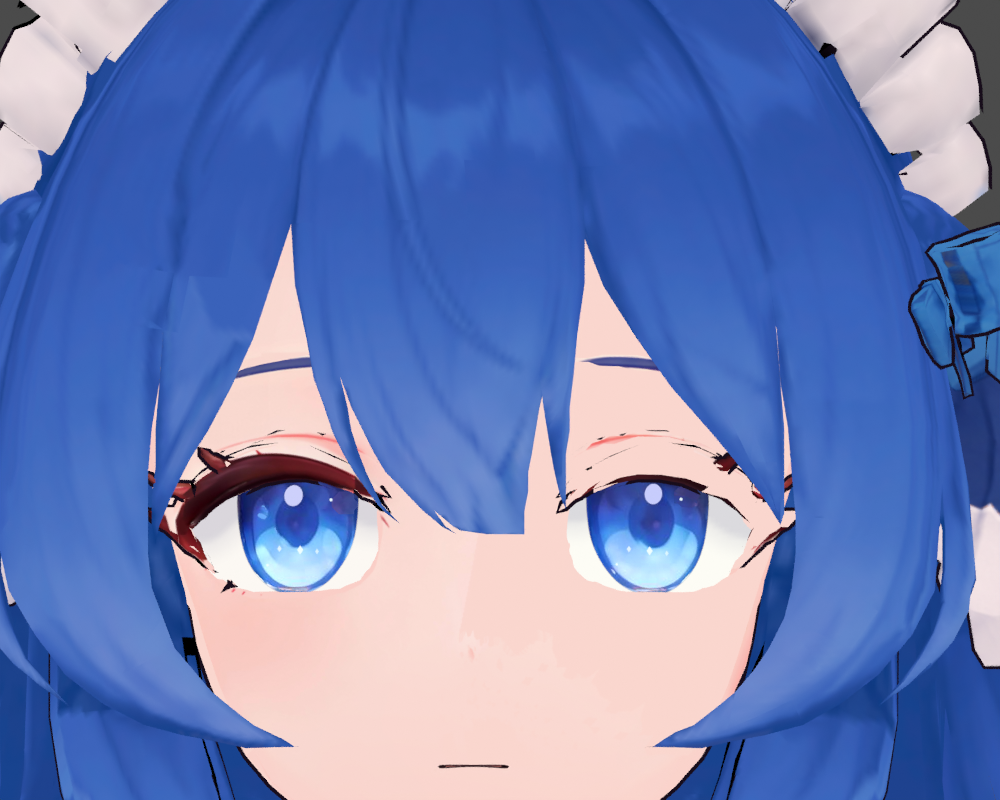
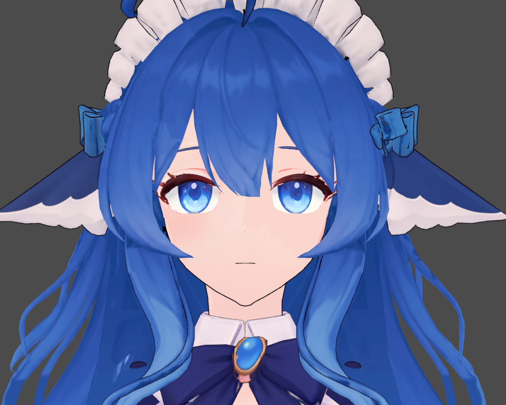

# 人物移植：实际构建尝试与排错记录

[路线说明](README.md) · [共用验证方法](../../docs/VERIFICATION.md) · [工具职责](../../docs/TOOLS.md)

以下整理的是 2026-11-01 至 2026-11-03 一次人物移植中的本地代码、对比报告与用户反馈。报告名用于交代证据来源；原报告、人物源、贴图和成品包不在本仓库内。选取的二维过程图片见 [图集](../../docs/IMAGES.md)。数字描述该次输入，不能作为其他模型的固定阈值或面编号。

## 案例一：脸部坏了，不是只看骨骼就能找到原因

**现象。** 转换后的 Blender 中嘴周已经发生明显变形，不能仅用游戏动画解释。

**确认的原因。** `repair_report.json` 与修复代码记录：原模型的 `Mouth transition fairing` Smooth 修改器在烘焙前被移除。它使用 `Mouth transition smooth` 顶点组，factor 为 0.7，迭代 120 次，实际影响 1878 个顶点。基础网格和用户看到的求值结果并不是同一形状。

**代码处理。** 对比源网格与保留 Smooth 的求值结果，恢复缺失的几何差值。后续外观导出改为先捕获依赖图求值后的顶点与法线，再在构建副本处理修改器，原编辑源保持不动。

**验证及边界。** 修复报告记录脸部最大误差约 0.0111 游戏单位、p99 误差约 `6.47e-6`。这些是几何比较结果，并不自动证明材质或游戏动作正确。后续仍分别做外观保留与绑定验证。

**可复用教训。** 保留“网格对象”不等于保留“可见形状”。代码必须盘点修改器、形态键、驱动和求值结果，不能删除影响外观的节点后再宣称只是换骨骼。

## 案例二：保留原貌的编辑副本，不等于游戏绑定已经完成

**尝试。** `rig_only.py` 从源工程建立副本，将目标游戏骨名和层级拟合到原角色，映射变形顶点组，同时保留原几何、UV、图像、材质节点、形态键和非 Armature 修改器。原辅助顶点组也保留，因为平滑和描边仍依赖它们。

**证据。** `rig_only_validation.json` 记录官方骨名／层级共 233 根；网格、图像、材质和节点组的差异列表为空；求值几何最大误差约 `8.61e-6`。原源文件没有改写。

**不能跳过的下一步。** 同一份报告明确写着 `canonical_source2_bind_validation=false`、`game_mod_rebuilt=false`。这说明它只验证了编辑源外观保持，尚未证明游戏标准绑定姿态兼容。

**可复用教训。** 用户可继续编辑的原貌副本，与供游戏编译的姿态适配副本可以有不同职责。代码必须记录输入处于哪一阶段，不能因为骨名相同就省略 bind/rest 和动作检查。

## 案例三：手臂拉长，是首次适配漏开关节处理

**现象。** 面部保留后，游戏动作里的腕部、手指和手臂出现严重拉伸。

**确认的差异。** `initial_findings.json` 显示坏版的 `fit_arm_joints=false`，此前正常版为 `true`。坏版上臂、前臂和手的关节偏差约为 83–95 游戏单位。这次证据支持“漏做必要适配”，不能写成“重复拟合导致首次故障”。

**尝试顺序。** 代码分别比较坏版、仅手臂适配、手臂加手指适配，以及旧正常版；`pose_comparison.json` 使用 48 个官方动作采样位置。累计超过三倍长度的边计数从坏版 21561 降到手臂加手指方案的 2527，最差 p99 边长比从约 4.651 降到 2.358。计数跨多个姿态累计，不能误写成单帧坏边数量。

还尝试了肩部额外权重平滑，但它造成衣服折痕，因此最终放弃。最终方案恢复关节和手指适配，不采用这次平滑试验。

**保留范围。** `final_corrected_appearance_validation.json` 记录头部 5415 个顶点误差为 0，UV、拓扑和材质槽保持；67 个材质节点结构、80 张打包图像字节保持，用户原文件没有改写。

**验证及边界。** 回读编译模型并比较 48 个动作位置，不能复现 Source 2 的运行时布料、动画混合图和着色。之后用户反馈冲刺大跳时“手臂正常”，应写成用户确认，不能改称全部动作自动测试通过。

**可复用教训。** 首次适配必须完成必要的关节／姿态工作；完成后才进入不重新拟合的 correction 流程。这两个阶段的规则不能互相替代。

## 案例四：发根与发梢使用不同的影响关系

**目标。** 使用目标英雄实际存在的头发骨链，让发根贴住头部，发梢保留摆动。

**代码方案。** `bind_official_hair.py` 检查官方骨存在，并拒绝未请求的额外骨链。后发使用 `ponytail_base`、`ponytail_chain_0..5`、`ponytail_chain_end`；前发和侧发使用相应官方链。发根以 `head` 为主要固定基准，往发梢按发束区域平滑过渡，每个顶点的权重归一化。

**证据。** `official_binding_audit.json` 记录 233 根官方骨的原静止位置和层级保持。左右转头、抬头、低头及链摆动共 5 个合成测试中，发根最大位置误差均小于 `1e-5` 游戏单位；链摆动时边长最大比约 1.527，数值均有限。

**边界。** 合成测试不含游戏物理。坐标分区和过渡阈值只适用于当时那份模型，不能复制到新发型就当作自动完成。权重也没有“头发上端统一高、下端统一低”的单一规则，必须说明相对于哪根骨。

**可复用教训。** 先验证发根跟随关系，再调整物理阻尼；阻尼无法弥补错误的骨骼归属。已有认可绑定不应为了少晃一点而整头重新赋权重。

## 案例五：1K 缩图与材质外观转换分开实施

**需求。** 用户选择最大边 1024，并要求保留原模型外貌。这个尺寸是该次明确要求，不是所有项目的默认值。

**第一步：图像副本缩小。** 1K 处理记录中有46张图：28张需要缩小，18张本来较小的图保持。脚本保留原文件，并检查几何、UV、形态键、修改器、骨骼与权重不变；重新打开输出确认资源存在。这一阶段尚未重建 MOD。

**第二步：让材质能在游戏表达。** 原材质不仅有 Base Color，还包含属性颜色、视角相关混合、透明和描边。`export_source.py` 在原UV上烘焙其可表达外观，再建立游戏材质；`game_material_validation.json` 另记录透明遮罩与白色自发光遮罩的处理。

**为什么不能混为一谈。** 图像尺寸没问题，并不代表节点表达保留；把同一彩图误当作自发光遮罩，会造成颜色再乘一次而变暗。眼部透明、隐藏面的遮罩和普通不透明材质也不能统一用一个参数。

**验证及边界。** 检查编辑源与构建副本、实际材质引用、通道用途及外观。缩图带来细节损失；包体积变小本身不能证明帧率改善，也不能用原PNG与有损编译纹理的字节差异直接判定外观失败。

## 案例六：睫毛缺色与描边穿出要分开修

| 修复前：缺色与零碎描边 | 修复后：正面检查 |
| --- | --- |
|  |  |

两图为历史 Blender 渲染，取景不同，用于说明问题和局部修复结果；游戏英雄展示的前后记录另见 [图集](../../docs/IMAGES.md)。

**已确认的事实。** 睫毛实际属于 `Body / Head_Skin - rebuilt mouth` 区域；名字像配件的 `Head_Accessories` 并不是目标。UV 对照和独立渲染显示：原图中的深红睫毛有一段在输出彩图中变成肤色，部分嘴补面与眼周共享UV。

**原因的证据等级。** `diagnosis.txt` 将“嘴补面的颜色覆盖烘到了睫毛共用区域”写为最可能原因。共享UV、颜色丢失和复现均已确认，但没有重跑旧烘焙逐像素追溯最后覆盖顺序。因此这是有较强证据的推断，不是已经追踪到每次写入的证明。

**局部颜色修复。** `candidate_report.json` 记录：只恢复明确眼周区域，改变17607个像素，Alpha及遮罩外RGBA保持；191个眼周面分配独立材质，16个共享UV面继续使用旧材质。这一步不改网格坐标、UV、权重或拓扑。

**局部描边修复。** 另一个问题来自描边壳的小片和眼孔薄圈穿出。先在诊断副本隐藏描边作对照，再定位局部面。两轮验证分别记录移除451面／289顶点、546面／0顶点；Body、其他网格与骨架保持，剩余描边另作坐标、UV、权重、材质和法线检查。这里没有把所有脸部描边或真正的睫毛一起删除。

**边界。** 上述数量是当时的网格版本，不能把面编号当成通用脚本。候选报告不等于已安装成品；后续英雄展示检查过睫毛，但没有追加整局战斗测试。

## 案例七：编译成功后还要保护 PHYS、动画与附件

**风险。** 模型编译返回成功，只能说明编译器产生了输出；它可能包含新的骨架、物理或附件变化。只修睫毛时，这些变化并不在任务范围内。

**代码检查。** `validate_compiled_structure.py` 从模型的 DATA、MDAT、外部引用和块表中提取结构，对照已认可版本。它比较骨名／层级／bind、动画和物理引用、附件、模型相机配置，并对存在的 `PHYS`、`PHVB`、`MRPH`、`AGRP`、`ANIM`、`ASEQ` 等块进行比较。

**实际结果。** 当前保留的结构报告记录旧新均233骨，没有缺失、新增或bind／父级变化。该模型存在的 PHYS、ANIM、AGRP、ASEQ 块逐字节相同，动画／物理引用、附件和相机配置保持。

**边界。** 这是结构保持的证据，不是布料在每个姿态都不会穿模的证明。不同模型可能包含不同块；新增骨骼或改变物理的任务也不能机械地要求它们全部相同，而应按允许变化建立检查。

## 案例八：只改候选允许的资源，避免下一轮回退

**代码方案。** 后续 `rebuild_character.py` 按 `correct → build → package` 分段。correction 对比39网格、骨架、UV、权重与材质面分配；材质恢复阶段保留认可模板和非颜色遮罩，只采纳本次变化的彩图。新增材质槽或意外引用变化会停止常规流程。

包合并以认可基础为起点，不直接分发整个编译目录。代码只更新允许的模型／彩图，保持原材质路径和参数，避免人物工程里的旧武器预览覆盖独立武器精修。编译后输入又改变时，不允许继续使用过期输出。

接受人物候选时，本地 `publish` 阶段备份基础、配置与组合输出，再更新人物基础，并组合现有技能／武器 payload；组合结果出现未批准差异则恢复备份。这一步避免“人物修好了，下一次改技能又回到旧版”。这里的 publish 是本地版本接受，不是向外公开资产。

**实际验证。** 保留的 correction 报告中，网格坐标和UV误差为0，权重变化仅浮点量级；未改输入的候选基础包与认可基础包相同，完整组合输出也恢复到同一校验值。

**必须保留的限制。** 该相同性包含管线复用认可模型／纹理的策略：输入没变时保留原资源，未要求原始编译输出直接替换它们。因此不能宣称编译器本身天然产生逐字节可重现的全部输出。验证证明的是这条有范围约束的重建与合并流程保持了认可结果。

## 这些案例共同留下什么

首次绑定、后续修正、图像优化、材质转换和资源合并应各自有明确输入与检查点。每个失败先用差异和实际求值定位，再作局部修复；没有证据时保留不确定性。

公开保存的是这些方法与结论。原始素材和完整构建工程由制作者在有权限的本机环境保存；本仓库不提供其下载。
