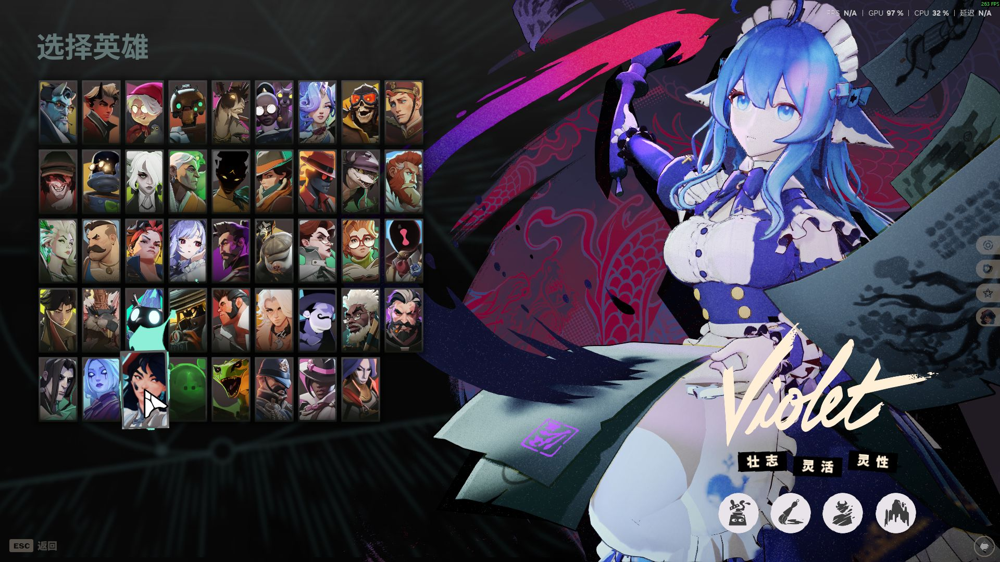

# 路线一：把自定义人物移植到游戏骨架

[返回总览](../../README.md) · [实际构建案例](CASES.md) · [工具职责](../../docs/TOOLS.md) · [共用验证方法](../../docs/VERIFICATION.md)

这条路线改变游戏中的人物外形，需要把制作者有权使用的角色适配到目标英雄的骨架、动画与资源结构。它与“沿用游戏原模型，只改彩图”的路线不同。本仓库记录 Codex 如何用代码分析、转换、编译和验证，不提供任何人物模型、贴图、编译资源、成品包或工具程序。

下面的策略来自一次实际人物移植及后续修复。脚本名用于说明当时的职责，伪代码用于解释数据关系；它们不意味着这里附有可以直接处理任意人物的完整程序。不同英雄、源骨架与材质需要重新确认。

## 制作结果示例



这是后续睫毛修复阶段的实际游戏英雄展示，展示人物移植与局部材质修复的结果。它不能替代冲刺、大跳或整局战斗验收。[查看修复前后与工具图片](../../docs/IMAGES.md)。

## 1. 先让代码读取完整外观状态

Codex 首先通过 Blender 后台 Python 读取用户源工程和目标游戏资源，生成快照。只统计顶点数不够：同一份基础网格经过修改器、形态键或材质节点后，外观可能完全不同。

快照至少覆盖：

- 网格坐标、拓扑、对象矩阵、每个 loop 的 UV、材质槽及面分配。
- 形态键值、驱动、修改器顺序及关联顶点组。
- 原骨架与目标骨架的骨名、层级、静止矩阵、对象变换、权重。
- 材质节点、节点组、图像引用、打包图片内容与色彩空间。
- 当前求值后的可见几何与法线，以及同机位的外观对照。

原文件只读保存，转换在独立副本中执行。相机、灯光和辅助物是否参与输出，要检查实际用途；Empty 可能承载表情驱动、父级或修改器目标，不能按类型整批删除。

```python
# 伪代码：快照职责，非可直接执行的完整脚本。
before = snapshot(source_scene, include_evaluated_geometry=True)
working = create_working_copy(source_scene)
allowed_changes = define_scope(current_request)
```

这一步直接来自脸部失败的教训：原模型依赖嘴周 Smooth 修改器，转换中删除它以后，基础网格仍在，但用户实际看到的脸已经被改变。见 [案例一](CASES.md#案例一脸部坏了不是只看骨骼就能找到原因)。

## 2. 分开处理首次适配与后续修正

这两种输入不能走同一条自动流程。

| 输入状态 | 代码要做的事 | 不能省略或重复的事 |
| --- | --- | --- |
| 尚未适配游戏的新角色 | 确认单位、轴向、比例、源姿态与目标静止姿态；建立骨骼映射，处理关节与手指适配，检查实际动作 | 只把骨名改成官方名称，不代表绑定矩阵已兼容 |
| 已经适配并通过游戏动作检查的角色 | 保持已认可的 rest/bind、权重与骨架，导出明确修改的内容 | 不再自动重绑、重新拟合手臂或重复转换姿态 |

历史移植里曾先制作“保留用户原貌”的 Blender 编辑副本：将官方骨名和层级拟合到原模型，保留网格、材质和形态键。这个副本的报告明确标记：**尚未通过游戏标准绑定姿态验证**。它是编辑状态，不能凭外观正常就直接视为可在游戏中正确播放动作的输出。

后续手臂坏版实际漏开了必要的 `fit_arm_joints`。修复恢复关节与手指适配后，再进入严格保留绑定的修正导出。因此，“不要重复拟合”适用于已经适配的模型，不是首次移植时跳过适配的理由。

```python
# 伪代码：状态分支必须依据已验证的输入记录。
if input_state == "new_character":
    inspect_source_and_target_spaces()
    map_bones_and_adapt_bind_pose()
    evaluate_official_action_samples()
elif input_state == "accepted_bound_character":
    export_manual_correction()
    assert_binding_and_weights_preserved()
else:
    stop_and_inspect_input_state()
```

## 3. 绑定策略按部位建立，再检查动作

身体、手指、头发、裙摆和武器不能仅按最近距离统一分配权重。代码需要检查每个部位的用途、原权重、目标骨链与预期动作。

该案例使用目标英雄已有的头发骨链。发根稳定跟随 `head`，发梢按发束逐渐过渡到官方头发链，并归一化每个顶点的影响。合成转头测试比较实际发根位置与头骨变换的预期位置，还记录边长伸缩和有限数值检查。

这里的权重分区、坐标阈值和骨名只是特定模型的实施方案。换一个模型时，应重新定位发根和发束。增大运行时阻尼不能修复错误绑定到脊柱的发根；合成转头也不能证明游戏物理没有穿模。

武器可以保留在同一场景内，但使用独立对象、UV、材质和正确附着关系，便于后续只改武器颜色，不需要把武器 Join 到身体。

## 4. 在构建副本中冻结可见几何与可表达材质

首次导出要保存的是用户确认过的外观，而不是简单丢弃修改器后的基础数据。

当时的外观导出代码先获取依赖图求值后的网格与法线，再在构建副本中处理修改器。这保留了嘴周平滑等可见效果。编辑源仍保留原有可编辑结构，不能以应用全部修改器的输出替代唯一源文件。

材质转换也不是“拿一张 Base Color PNG 接回去”。该模型包含 Attribute 颜色覆盖、视角相关的 Facing 混合、描边及透明关系。代码在原 UV 上烘焙能够表达的颜色结果，转换为目标游戏可用的材质，并单独处理透明和发光遮罩，再对照外观。

烘焙不是自动正确的保证：重叠 UV、多个面共用材质、视角相关节点都可能产生问题。后来睫毛颜色缺段就需要按 UV 和面材质归属另做局部修复，见 [案例六](CASES.md#案例六睫毛缺色与描边穿出要分开修)。

分辨率优化在另一个副本中执行。本次用户选择最大边 1024，所以脚本按比例缩图，保留小图、原尺寸源和各通道用途。1K 不是所有新项目的默认要求，也不能据包体积推断帧率改善。

## 5. 已绑定人物采用受约束的 correction 导出

日常修改走过的代码职责如下：

| 代码步骤 | 做什么 | 检查点 |
| --- | --- | --- |
| 输入登记 | 读取明确指定的编辑源，记录哈希，复制到工作目录 | 不误读旧构建副本 |
| manual-correction | 使用既有准备元数据导出已绑定人物 | 不重新绑骨或拟合手臂 |
| 导出对比 | 比较源与输出的网格、UV、权重、材质面分配及骨架 | 不允许无关变化 |
| 材质恢复 | 恢复已认可的材质模板，仅映射本次有变化的颜色图 | 保护透明、发光及其他非颜色遮罩 |
| 编译 | 调用当前兼容的工具链，记录输入、日志和输出 | 编译期间输入不能变化 |
| 结构检查 | 比较骨架、动画、物理、附件和资源引用 | 不能只以进程返回成功判断 |
| 最小合并 | 只替换允许的资源，写出候选包并回读 | 不回退技能和独立武器精修 |

新增材质、改透明机制、增加物体或重绑骨骼超出这条常规入口的约束，应明确扩大本轮允许变化的清单。不能为了通过构建就删除断言。

## 6. 编译结构与最终包分别检查

当时的编译验证器读取模型 DATA、MDAT、外部引用与二进制块表，比较：

- 骨名、父级、bind 位置、旋转与缩放。
- 动画和物理的外部路径及资源标识。
- 模型内存在的 `PHYS`、`PHVB`、`MRPH`、`AGRP`、`ANIM`、`ASEQ` 等块。
- 武器等附件、模型相机配置及材质引用变化。

具体块是否存在由资源决定，不能假定每个模型都有全部块。对没有修改需求的物理和动画，案例采用逐字节保持的验证；对允许修改的内容则按本轮目标另建检查。

最终合并从当前满意的基础包出发，而不是把整个编译目录塞进 VPK。代码保留认可材质的资源名和 shader 参数，只把发生变化的彩图映射回原槽位；独立武器输入优先于人物中的旧武器预览。

```python
# 伪代码：允许变化范围与回读验证。
candidate = copy_resource_map(accepted_base)
for path in approved_resource_changes:
    candidate[path] = verified_compiled_payload[path]
assert_unchanged_outside_scope(accepted_base, candidate)
write_candidate_package(candidate)
assert read_back_candidate() == candidate
```

## 7. 接受新人物后，再更新后续技能构建的基础

候选正确后，需要把人物修复同步到武器／技能工作流使用的基础包，否则下一次改技能可能重新带回旧脸或旧手臂。

当时的 `publish` 阶段先备份基础、配置与当前输出，更新基础哈希，再组合已有且有效的技能／武器资源；组合后只允许出现本轮审核过的人物差异。失败则恢复备份。这是接受已验证候选的本地构建动作，不是公开上传的含义。

管线也拒绝过期输入：图像或 Blender 在编译后有变化，不能继续复用旧编译结果打包。只合并已验证 payload 的 `package-only` 阶段，不适合用来跳过新颜色的生成。

最后按 [验证方法](../../docs/VERIFICATION.md) 分别报告数据、Blender、编译结构、安装和游戏检查。48 个动作采样不等于整局战斗测试；英雄展示正常也不能证明冲刺大跳正常。
